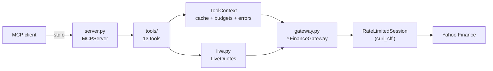

# Architecture

yfinance-agent-mcp is a small Python package built on the official
[MCP Python SDK](https://py.sdk.modelcontextprotocol.io/) (`MCPServer`) and
[yfinance](https://github.com/ranaroussi/yfinance). Its main job is to hide yfinance's
process-wide behavior behind an interface that is safe for a long-running agent.

## Modules

| Module | Responsibility |
|---|---|
| `gateway.py` | The only module that imports yfinance. `MarketDataGateway` is the interface the tools use; `YFinanceGateway` implements it. |
| `ratelimit.py` | Token bucket for all HTTP requests and the pause after HTTP 429. |
| `cache.py` | Result cache with an expiry time per category of data. |
| `shaping.py` | Turns pandas output into JSON-safe records, UTC timestamps and size-limited answers. |
| `indicators.py` | Returns, moving averages, RSI, ATR, 52-week range and volume ratio from bars. |
| `models.py` | Pydantic models for every answer: the structured output schemas. |
| `tools/` | One module per group of tools; each registers its tools on the server. |
| `live.py` | One shared websocket to Yahoo's price stream, with the latest tick per symbol. |
| `config.py`, `server.py`, `__main__.py` | Settings from environment variables, server wiring, command line. |

## The gateway

yfinance is convenient but built for scripts, not servers. The gateway deals with that once,
so the tools do not have to:

- **Errors instead of empty data.** yfinance hides exceptions by default and returns empty
  frames; the gateway turns that off and maps every yfinance exception to one of four
  `DomainError` types (`RateLimited`, `NotFound`, `InvalidArgument`, `UpstreamError`).
- **Freshness.** yfinance caches some responses for the life of the process, and `Ticker`
  objects memoize what they fetched. The gateway clears that cache and builds new objects
  for every call; the server's own cache decides how long an answer is reused.
- **One paced session.** All requests go through one `curl_cffi` session that impersonates
  Chrome and waits for the rate limiter before every request, including yfinance's own
  cookie and crumb requests.
- **Project data shapes.** The gateway returns the project's models or normalized frames
  (lower-case bar columns on a UTC index), so tools never depend on yfinance's column names.
- **Nothing on stdout.** stdout carries MCP messages; the gateway disables yfinance's
  progress output and websocket prints.

A test enforces that no other module imports yfinance.

## A tool call

1. The SDK validates the arguments against the tool's schema.
2. The tool checks symbols and ranges (bad input becomes `invalid_argument`).
3. `ToolContext.answer` returns a cached answer if it has not expired, or builds a new one
   through the gateway.
4. The answer is fitted to the size budget, and `DomainError`s become MCP tool errors with
   their code and advice.

## Design decisions

- **13 consolidated tools** instead of one tool per yfinance method: fewer, better tool
  descriptions for the model, answers shaped for decisions, and `get_ticker_dataset` for the
  long tail.
- **Read-only, stdio only.** The server cannot trade and opens no network port; order
  execution belongs in a separate, gated tool.
- **Per-symbol requests** for price history rather than `yfinance.download`, because
  `download` swallows per-symbol errors, including rate limits.
- **Live prices in the server process.** One websocket shared by every call; subscriptions
  expire after 10 idle minutes and a dropped connection is reopened.

## Testing seams

`MarketDataGateway` is the seam: unit tests and in-process integration tests use an in-memory
`FakeGateway`, contract tests run the real gateway against a fake HTTP layer, and live tests
run everything against Yahoo. See [testing](development/testing.md).
