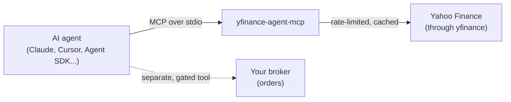

# yfinance-agent-mcp

**A read-only [Model Context Protocol](https://modelcontextprotocol.io/) server that gives AI
agents market data from Yahoo Finance through [yfinance](https://github.com/ranaroussi/yfinance).**

It is built for agents that follow news and trends and prepare trading decisions: answers
are small, timestamped and honest about delays, and failures come back as errors an agent
can act on, never as empty data.

```bash
uvx yfinance-agent-mcp
```

[Install it](getting-started/installation.md){ .md-button .md-button--primary }
[Try a first call](getting-started/quickstart.md){ .md-button }
[See the tools](tools/index.md){ .md-button }

## What an agent gets

<div class="grid cards" markdown>

-   **13 tools that cover yfinance**

    ---

    Symbols, quotes, market status, price history, news, screeners, sectors, earnings and
    economic calendars, fundamentals, analyst views, options, holders and live prices.

-   **Answers that fit in context**

    ---

    Price history arrives with returns, SMA 20/50/200, RSI 14, ATR 14 and the 52-week
    range. Every answer stays under 20,000 characters unless you ask for `detailed`.

-   **Freshness you can check**

    ---

    Every answer carries `as_of`. Quotes add `market_state`, `quote_source` and
    `delay_min`, because many exchanges are delayed by 15 minutes or more.

-   **Errors an agent can act on**

    ---

    `rate_limited` says how long to wait, `invalid_argument` lists the valid values,
    `not_found` and `upstream_error` say what happened.

-   **Gentle with Yahoo**

    ---

    One shared session, a process-wide rate limit, a pause after HTTP 429, and a
    short-lived cache with its own expiry time per kind of data.

-   **Safe with news**

    ---

    Publisher text arrives in fields marked `untrusted`, so agents treat headlines as
    data, never as instructions. The server cannot place orders.

</div>

## How it fits into an agent



The server answers research questions. Placing orders belongs in a separate tool that you
control and gate, which is why this server is read-only.

## Next steps

- [Installation](getting-started/installation.md): uv, `uvx`, and pinning a version.
- [Client guides](clients/claude-code.md): Claude Code, Claude Desktop, Cursor, VS Code,
  Windsurf, the Claude Agent SDK and other MCP clients.
- [Building a research agent](guides/research-agent.md): a workflow from news to a
  decision record.
- [Disclaimer](disclaimer.md): yfinance-agent-mcp is not affiliated with Yahoo, the data
  is for personal use, and nothing here is investment advice.
